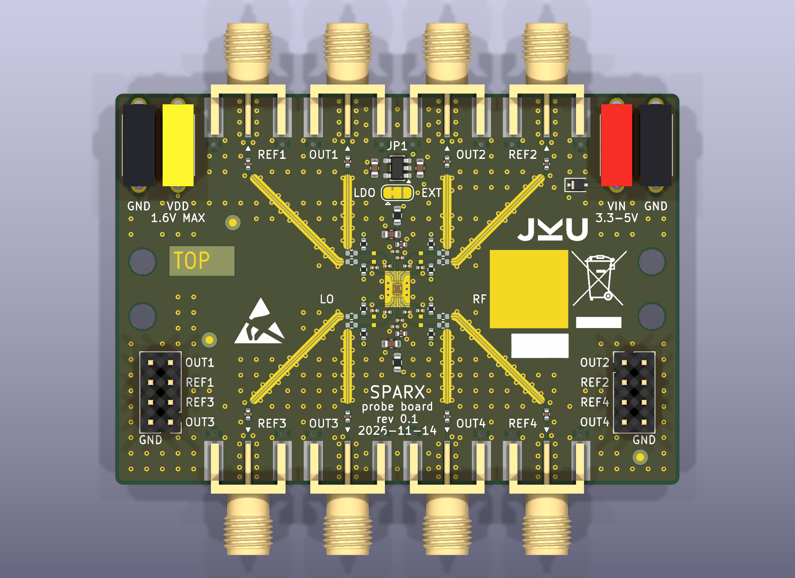
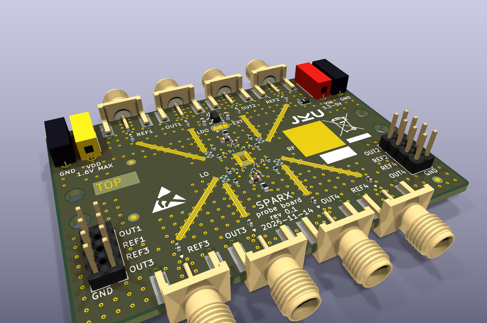
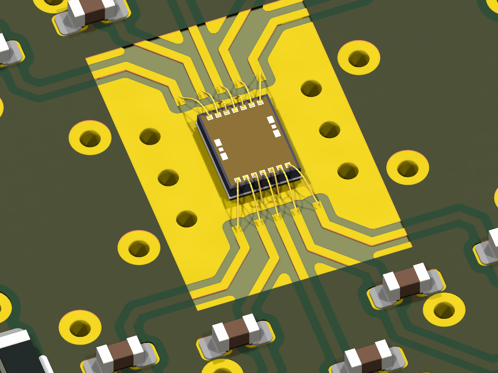
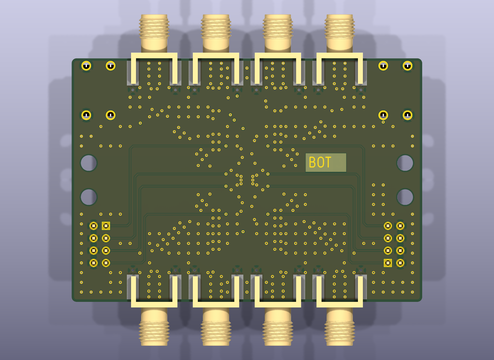

# SPARX probe board

KiCad 10 project of the board that carries a SPARX die on the wafer prober.
The die is glued onto the board and gold ball bonded at its top and bottom pad rows. LO and RF are probed from the left and the right with GSG probes. The four power detectors are read out with a differential probe on the board or through edge SMAs.

<p align="center">
  
  
</p>
<p align="center">
  
  
</p>

## Files

| File | Contents |
| --- | --- |
| `sparx_probe_board.kicad_pro` | Project: net classes (`DIE`, `RF_50`, `Power`), design rules, track and via presets |
| `sparx_probe_board.kicad_sch` | Root sheet: die, supply, VDD decoupling, DC monitor headers, mechanics |
| `detector.kicad_sch` | Readout of one detector, instantiated four times as `Detector 1` to `Detector 4` |
| `sparx_probe_board.kicad_pcb` | Board, revision 0.1 |
| `sparx_probe_board.kicad_dru` | Custom rules: the stricter value of JLCPCB and Aisler per rule, plus house rules |
| `lib/` | Project symbols, footprints (parts and the board-only logos) and the 3D models of the die with its bond wires and of the tip jacks |
| `render/` | Renders of the board |

Stock parts use the KiCad 10 libraries, and their 3D models resolve through `${KICAD10_3DMODEL_DIR}`. The SMA footprint is KiCad's `SMA_Molex_73251-1153_EdgeMount_Horizontal` with the changes listed in its description.

## Die and bond area

| Item | Value |
| --- | --- |
| Die | 1.05 × 1.35 × 0.2 mm, pads 2 × 7 at 125 µm pitch with 80.8 µm openings |
| Pad rows | `REF OUT VSS VDD VSS OUT REF`, pad 1 top left, detectors 1 to 4 top left, top right, bottom left, bottom right |
| Die land | 1.25 × 1.55 mm of `GND` copper inside a 3.2 × 4.6 mm solder mask window |
| Bond fingers | One row, 0.125 × 0.40 mm, 1.10 to 1.50 mm from the die centre: `OUT` at x ±0.27 mm, `VDD` at 0, `REF` fanned out to ±0.60 mm |
| `VSS` | Pads 3, 5, 10 and 12 bonded down onto 0.125 × 0.25 mm tongues of the land, stitch 0.90 mm from the die centre |
| Wire length (planar, to a landing 1.20 mm from the die centre) | `OUT` and `VDD` 0.63 mm, `REF` 0.67 mm, `VSS` 0.33 mm |

Wire length hardly matters below 2 GHz IF: 0.8 nH against 1.2 nH on `OUT` moves the detector response by 0.4 dB at 2 GHz.

Gold ball bonding on ENIG is marginal. Neither fab offers ENEPIG or soft gold, and Aisler's ENIG carries 0.05 to 0.1 µm of gold. Pull-test on the 10 × 10 mm bond test pad `TP1` first, and use ball-stitch-on-ball if the stitch does not hold.

## Probing

LO comes from the left and RF from the right, both GSG at 125 µm pitch. The RF pads sit 0.117 mm above the LO axis.
Along both probe axes the board keeps a corridor that is ±1.2 mm wide at the die and widens to ±8 mm at 14 mm from the die centre. Inside it are only 0201 capacitors and 0402 resistors (at most 0.35 mm tall), flat pads and the markings below. The mounting holes `H1` to `H4` sit at x ±32.5 mm, 3.5 mm beside the axes: use low screw heads there, or hold the board by vacuum.

The LO pad wants about +12 dBm, which puts about −6 dBm on each detector. The ZC170 (more than +6 dBm) therefore belongs on LO and the ZC220 (more than −2 dBm) on RF.

## Detector readout

Sheet `detector.kicad_sch`. The first digit of a reference is the detector, for example `R103` belongs to detector 1.

| Reference | Part | Default | Function |
| --- | --- | --- | --- |
| `Ck01`, `Ck02` | 3.3 pF C0G 0201 | fitted | Off-chip filter capacitor of `OUT` and `REF` at the finger |
| `Jk03` | 2 pads 0.5 mm at 1.1 mm pitch | | Differential probe: pin 1 `OUT`, pin 2 `REF` |
| `Rk01`, `Rk02` | 10 kΩ 0402 | fitted | DC taps to the monitor headers |
| `Rk03`, `Rk04` | 0 Ω 0402 | not fitted | Links to the SMA lines |
| `Ck03`, `Ck04` | 100 nF 0402 | fitted | DC blocks of the SMA lines |
| `Jk01`, `Jk02` | Molex 73251-1153 | fitted | Edge SMAs of `OUT` and `REF` |

The off-chip capacitor sets the IF bandwidth. The testbenches use 5 pF (−3 dB at 1.29 GHz), and the 3.3 pF assume 1.5 to 2 pF of probe input and trace. Adjust `Ck01` and `Ck02` once the probe is known.

Two readout modes:

- Differential probe on `Jk03` with the links out (default). It reads `OUT − REF` and loads each node only with the probe's input impedance.
- SMAs with `Rk03` and `Rk04` fitted, subtracted in the oscilloscope. `OUT` drives with about 25 Ω but `REF` with about 250 Ω, so the 50 Ω inputs cost 6.6 dB of `OUT − REF` at low IF and 4 dB at 2 GHz.

The SMA lines are grounded coplanar waveguides on `F.Cu` over `In1.Cu`, 0.18 mm wide with 0.15 mm gaps.

The DC monitor headers carry the detector voltages through the 10 kΩ taps. Odd pins are signals, even pins `GND`.

| Header | Pin 1 | Pin 3 | Pin 5 | Pin 7 |
| --- | --- | --- | --- | --- |
| `J4` (left) | `OUT3` | `REF3` | `REF1` | `OUT1` |
| `J5` (right) | `OUT2` | `REF2` | `REF4` | `OUT4` |

## Supply

| `JP1` | Source |
| --- | --- |
| 1-2 (default, bridged) | `VIN` of 3.3 to 5 V on the red jack `J1` (black `J3`), through the reverse polarity diode `D1` into the LP5907 LDO `U2` at 1.5 V |
| 2-3 | `VDD` straight from the yellow jack `J2` (black `J6`), 1.4 to 1.6 V, never above 1.6 V. Cut the 1-2 bridge first. |

`VDD` reaches the die pads 4 and 11 through the 0 Ω links `R1` and `R2`, which can be replaced by current shunts. Each pad has 100 pF and 1 nF C0G 0201 at the finger, 100 nF 0402 and 1 µF 0603. The die draws 17.5 mA (4.36 mA per detector, simulated). The LDO sees 3.2 µF on its output, within the 10 µF limit of the LP5907.

## Markings

- Layer marker in the LO corridor: `TOP` (`F.Cu`) and `2` (`In1.Cu`) are read from the top, `3` (`In2.Cu`) and `BOT` (`B.Cu`), mirrored, from the bottom. The copper text is 2.0 mm high, 1.7 mm wide, with 0.25 mm stroke. Each pair sits in rule areas that forbid only the pour (8.5 × 4.0 mm on the outer layer, 2.8 × 4.0 mm around each inner digit), under a mask window 0.1 mm inside the area, so a delivered board shows its layer order. The inner digits show through the laminate on the board, not in KiCad's render.
- Write-on field for the serial number: a filled 7.2 × 3.0 mm silkscreen rectangle under the bond test pad.
- Logos as filled silkscreen polygons in board-only footprints (no schematic symbol, not in the BOM or the position files): JKU 9.0 × 2.9 mm, ESD 6.5 × 5.9 mm, WEEE 7.0 × 9.9 mm.
- The WEEE logo is KiCad's stock artwork scaled to 7.0 mm width. Below that its 45° strokes are thinner than the 0.15 mm silkscreen line: a 0.15 mm opening removes 16 % of the 5.6 × 8 mm stock size and 0.3 % at 7.0 mm.

## Fabrication

The board fits both JLCPCB and Aisler on one rule set, so either fab can build it unchanged.

| Rule | Value |
| --- | --- |
| Track and space | 0.125 mm |
| Vias | 0.25 to 0.45 mm drill, 0.1 mm ring, 0.45 mm diameter or more (the board uses 0.3 mm in 0.6 mm) |
| Plated through holes | 0.3 mm ring |
| Hole to hole | 0.45 mm, via to via 0.3 mm |
| Hole to copper | 0.28 mm, via hole 0.25 mm |
| Copper to edge | 0.5 mm (house rule, fabs 0.3 mm) |
| Silkscreen text | 1.0 mm high, 0.15 mm stroke |

The board file carries Aisler's 4-layer stackup: 1.6 mm, ENIG, 35 µm copper, 0.138 mm prepreg (εr 4.3) between `F.Cu` and `In1.Cu`, 1.2 mm core. The CPWG impedance depends on the outer prepreg:

| Stackup | CPWG 0.18 mm, gap 0.15 mm |
| --- | --- |
| Aisler 4-layer 1.6 mm | 53.8 Ω |
| JLCPCB `JLC04161H-3313` | 47.1 Ω |
| JLCPCB `JLC04161H-7628` (JLCPCB default) | 61.6 Ω, select 3313 instead |

Order ENIG at either fab. For bonding, Aisler's gold is the better of the two.

## Checks

The project is ERC clean, the schematic and the board agree (DRC with `--schematic-parity`), and DRC reports no errors and no unconnected items. Two warning classes are left on purpose:

- 199 `solder_mask_bridge`: 102 inside the bond window, which is open over the die land, the fingers and the ground around them, and 97 where the open mask strips over the 50 Ω lines expose the line next to the untented ground fence vias. The project sets this check to warning.
- 32 `track_angle`: the house 45° rule at the T-junctions where the 10 kΩ taps leave the eight die nets.

From the repo root:

```sh
mkdir -p build
kicad-cli sch erc --severity-all --format json -o build/pcb_erc.json pcb/sparx_probe_board.kicad_sch
kicad-cli pcb drc --severity-all --schematic-parity --format json -o build/pcb_drc.json pcb/sparx_probe_board.kicad_pcb
kicad-cli pcb render --quality high --use-board-stackup-colors -o build/board.png pcb/sparx_probe_board.kicad_pcb
```

## Open points

- Probe tips and beak clearance against the 0201 and 0402 parts beside the die.
- Differential probe model: input capacitance (sets `Ck01`, `Ck02`) and tip spacing (pads at 1.1 mm pitch).
- Probe loss at 160 GHz and the LO power that reaches the pad.
- Bond trial on ENIG with the bonder operator.
