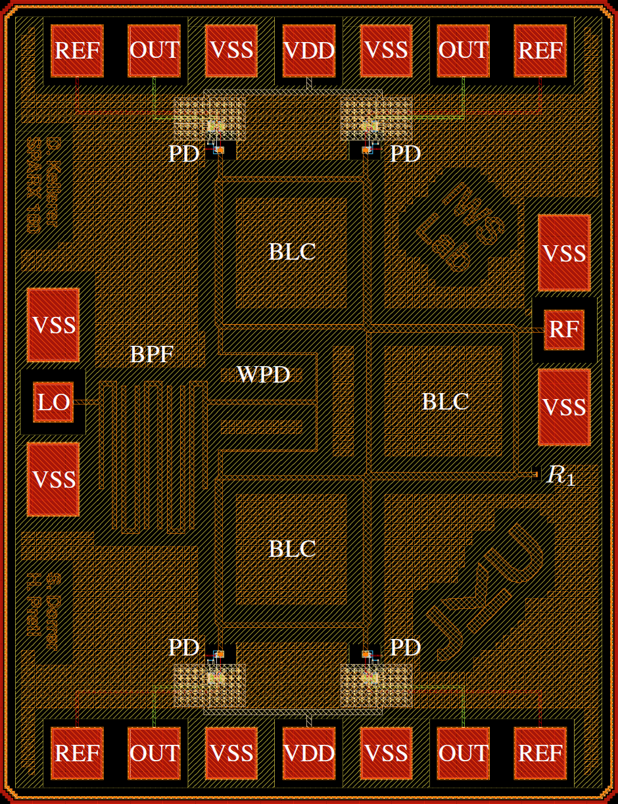
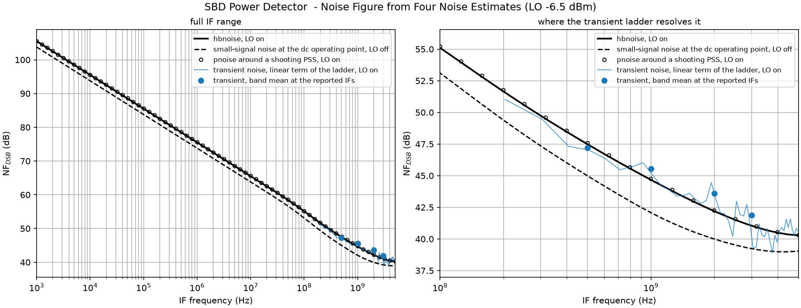

# SPARX: An Open-Source, Automated, Programmatically Generated, Frequency-Scalable Six-Port Receiver in 130-nm CMOS

Submission to the IEEE SSCS Open-Source Ecosystem “Code-a-Chip” Travel Grant Awards at [ISSCC'27](https://www.isscc.org/), official submission repository https://github.com/sscs-ose/sscs-ose-code-a-chip.github.io.

**Team:** Simon Dorrer\*, David Kellerer-Pirklbauer\*, and Harald Pretl, Institute for Integrated Circuits and Quantum Computing, Johannes Kepler University (JKU), Linz, Austria

\*S. Dorrer and D. Kellerer-Pirklbauer contributed equally to this work, see the author contributions at the end of the notebook.

**Paper:** S. Dorrer, D. Kellerer-Pirklbauer, G. Zachl, and H. Pretl, “SPARX: An Open-Source, Automated, Programmatically Generated, Frequency-Scalable Six-Port Receiver in 130-nm CMOS,” accepted and presented at the 2026 IEEE Nordic Circuits and Systems Conference (NorCAS), not yet available in IEEE Xplore.

**Repository:** https://github.com/iic-jku/SG13CMOS_SPARX, with the documentation at https://iic-jku.github.io/SG13CMOS_SPARX/

  

SPARX is a CMOS-only six-port receiver in the 130-nm IHP Open-PDK. A 160 GHz version was taped out on an IHP open MPW run in March 2026. One Python program on GDSFactory generates the complete layout from a single input, the design frequency, and closed-form models size every RF structure from 60 GHz to 300 GHz ([video](assets/sparx_gen_60ghz_to_300ghz.mp4)). The notebook generates the chip, checks it with the KLayout DRC, fits the EM result of the passive core into a noisy lumped-element netlist with snp2le, and characterizes the Schottky-diode power detector and the receiver in VACASK. To the authors' knowledge, SPARX is the first RF building block characterized with harmonic balance and periodic steady-state analyses, including their small-signal and noise extensions, using only open-source tools.

## Key Results

All results are for the 160 GHz design and come from the outputs saved in the notebook.

| Section | Step | Result |
|---|---|---|
| 3 | layout generation | complete chip from the design frequency alone, every RF dimension from closed-form models |
| 4.2 | full top-level KLayout DRC (`regular`, all rules) | no violations apart from the 33 antenna violations that IHP waived for the tapeout |
| 5.2 | snp2le fit of the 7-port EM result of the core | passive lumped-element netlist with thermal noise, all 49 S-parameters within 0.45 dB and 9.9° |
| 5.3 | detector transfer curve, HB and PSS | responsivity of 41.2 V/W, 1 dB compression point at -2.7 dBm |
| 5.4 | detector noise, HBNOISE and PNOISE | DSB noise figure of 42.2 dB at a 2 GHz IF, 2.2 dB above the small-signal noise at the dc operating point |
| 5.5 | detector transient noise | within 1.4 dB of HBNOISE |
| 5.6 | receiver with post-layout detectors | I/Q amplitude imbalance of 2.0 dB and phase difference of 85.4°, predicted by the detector-loaded EM core within 0.1 dB and 0.1° |
| 5.7 | receiver noise figure | 48.5 dB at the I output and 46.3 dB at the Q output |

  

Noise figure of the power detector at -6.5 dBm of LO from four noise estimates (Section 5.5). With the LO on, PNOISE agrees with HBNOISE within 0.1 dB and transient noise within 1.4 dB, while the small-signal noise at the dc operating point is 1.7 dB to 2.6 dB optimistic over the IF.

## Reading and Running the Notebook

The notebook [`SPARX_JKU_ISSCC2027.ipynb`](SPARX_JKU_ISSCC2027.ipynb) is saved with the outputs of a complete run, so it can be read without running it. Its reading guide after the abstract gives an overview in two minutes. If GitHub does not render the notebook, open the [PDF](SPARX_JKU_ISSCC2027.pdf) or [nbviewer](https://nbviewer.org/github/iic-jku/SG13CMOS_SPARX/blob/next_release/sscs-ose-code-a-chip/SPARX_JKU_ISSCC2027.ipynb).

To run it, open the notebook in Google Colab with the badge above and select *Runtime → Run all*. It installs every tool itself, at the versions listed in its Section 2, and takes one to two hours on the free tier. With `FULL_RUN = 0` in the cell after the reading guide, it skips the DRC and the three longest simulations, whose stored outputs are then not regenerated, and finishes in about 5 minutes.

The complete flow, including the EM simulations with AWS Palace, LVS, and parasitic extraction, is in the [SPARX repository](https://github.com/iic-jku/SG13CMOS_SPARX). It runs in the [IIC-OSIC-TOOLS](https://github.com/iic-jku/IIC-OSIC-TOOLS) container (tag 2026.10 or later) with `make all`.

## Files

| File | Contents |
|---|---|
| `SPARX_JKU_ISSCC2027.ipynb` | the notebook, with the outputs of a complete run |
| `SPARX_JKU_ISSCC2027.pdf`, `SPARX_JKU_ISSCC2027.html` | exports of the notebook |
| `sparx_top.gds` | the 160 GHz layout that the notebook generates |
| `assets/` | the block diagram, the video, and the logo layouts that the notebook uses, and the figures of this README |
| `LICENSE` | the Solderpad Hardware License v2.1 |

## License

`Apache-2.0 WITH SHL-2.1`, the license of the SPARX repository, see [`LICENSE`](LICENSE). The Solderpad Hardware License v2.1 is a wraparound of the Apache License 2.0 for hardware, and it allows anyone to treat the work as released under the Apache License 2.0 instead.
